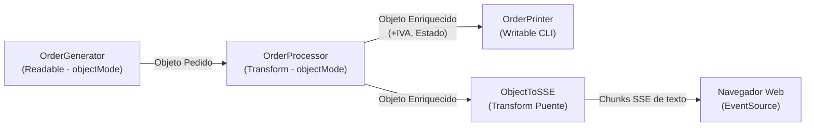

# 🌊 Demostración de Stream de Objetos en Node.js

Este proyecto es un ejemplo práctico, claro y visual de cómo funcionan los **Streams en modo objeto (`objectMode: true`)** en Node.js.

No requiere ninguna dependencia externa (`0 npm dependencies`), utilizando únicamente las APIs nativas de Node.js (`node:stream`, `node:http`).

---

## 💡 ¿Qué es un Stream de Objetos?

Por defecto, los streams en Node.js operan sobre `Buffer` o `string` (datos binarios o texto). Sin embargo, cuando se activa `{ objectMode: true }`:

- El stream puede transportar **cualquier objeto JavaScript**, número, booleano o estructura de datos directamente en memoria.
- Permite procesar grandes volúmenes de datos objeto por objeto sin tener que cargar colecciones gigantescas en memoria de golpe (evitando problemas de *Out of Memory*).
- Gestiona automáticamente la contrapresión (*backpressure*).

---

## 🏗 Arquitectura del Pipeline



1. **`OrderGeneratorStream` ([src/streams/orderGenerator.js](file:///home/joaco/Documentos/Uls/TCos/Tecnologias-Construccion/stream-objetos/src/streams/orderGenerator.js))**:
   - Stream de lectura (`Readable`).
   - Emite periódicamente objetos JavaScript simulando pedidos (`orderId`, `customer`, `product`, `amount`, etc.).
2. **`OrderProcessorStream` ([src/streams/orderProcessor.js](file:///home/joaco/Documentos/Uls/TCos/Tecnologias-Construccion/stream-objetos/src/streams/orderProcessor.js))**:
   - Stream de transformación (`Transform`).
   - Recibe el objeto, calcula impuestos (IVA 16%), clasifica el pedido según su monto (`APROBADO`, `REQUIERE_VERIFICACION`, `EXPRESS`) y emite el objeto transformado.
3. **`OrderPrinterStream` ([src/streams/orderPrinter.js](file:///home/joaco/Documentos/Uls/TCos/Tecnologias-Construccion/stream-objetos/src/streams/orderPrinter.js))**:
   - Stream de escritura (`Writable`).
   - Consume los objetos enriquecidos y los muestra en la consola con formato y colores ANSI.
4. **`ObjectToSSEStream` ([src/server.js](file:///home/joaco/Documentos/Uls/TCos/Tecnologias-Construccion/stream-objetos/src/server.js))**:
   - Stream puente que demuestra cómo convertir de `writableObjectMode: true` a `readableObjectMode: false` para transmitir datos a la red HTTP.

---

## 🚀 Cómo Ejecutarlo

### Opción 1: En la Terminal (CLI)
Para ver el flujo de objetos procesándose en tiempo real en la consola:

```bash
npm run cli
# O directamente:
node src/cli.js
```

### Opción 2: En el Navegador Web (Dashboard Interactivo)
Para ver los objetos aparecer en tiempo real en una interfaz gráfica:

```bash
npm start
# O directamente:
node src/server.js
```

Luego abre tu navegador en:
👉 **[http://localhost:3000](http://localhost:3000)**

En la interfaz puedes:
- Elegir la cantidad de objetos a generar (5, 12, 25, 50).
- Ajustar la velocidad/intervalo del stream (150ms, 400ms, 800ms).
- Pausar o detener el flujo en cualquier momento.
- Ver las métricas acumuladas (Total facturado, IVA, objetos procesados).
- Inspeccionar el JSON crudo de cada objeto emitido por el stream.

---

## 📁 Estructura del Proyecto

```text
stream-objetos/
├── package.json
├── README.md
├── src/
│   ├── streams/
│   │   ├── orderGenerator.js     # Readable stream (objectMode: true)
│   │   ├── orderProcessor.js     # Transform stream (objectMode: true)
│   │   └── orderPrinter.js       # Writable stream (objectMode: true)
│   ├── cli.js                    # Script ejecutable en consola
│   └── server.js                 # Servidor HTTP con Server-Sent Events (SSE)
└── public/
    └── index.html                # Interfaz web interactiva
```
